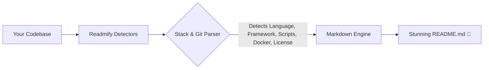

<div align="center">

# ⚡ Readmify

<p align="center">
  <strong>Turn any codebase into a breathtaking, production-grade GitHub README in seconds.</strong>
</p>

<p align="center">
  <a href="https://npmjs.com/package/readmify"></a>
  <a href="#"></a>
  <a href="LICENSE"></a>
  <a href="https://github.com/pulkitbisht/readmify/stargazers"></a>
  <a href="#"></a>
</p>

</div>

<hr />

## 💡 Why Readmify?

You just spent 40 hours building an awesome open-source project. The hardest part is over, but writing documentation, setting up Shields.io badges, making installation commands, and formatting markdown is tedious. 

**Readmify solves this instantly.** Run one command in your project directory: it inspects your package managers, frameworks, Docker files, and scripts, then automatically generates a stunning, star-worthy `README.md`.

---

## 🚀 Quick Start

No installation required! Just run this in any repository:

```bash
npx readmify
```

Or install globally:

```bash
npm install -g readmify
readmify
```

---

## ✨ Features

- 🔍 **Intelligent Stack Detection**: Automatically recognizes TypeScript, JavaScript, Python, Rust, Go, Next.js, React, FastAPI, Docker, and more.
- 🎨 **Multiple Designer Templates**:
  - `modern`: Centered hero, brand badges, features grid, quickstart, scripts table.
  - `showcase`: Visual product focus, architecture diagrams, roadmap.
  - `minimal`: Clean, concise, zero-fluff developer documentation.
- 🛡️ **Auto-Generated Shields.io Badges**: Official brand logos and hex colors for languages, frameworks, licenses, and GitHub stats.
- 📦 **Script & Env Extraction**: Detects all runnable npm/cargo/poetry scripts and environment variables from `.env.example`.
- 🔒 **Safe By Default**: If a `README.md` already exists, Readmify offers to back it up to `README.old.md` or preview changes first.
- ⚡ **Zero Configuration**: Works 100% offline out-of-the-box.

---

## 🛠️ CLI Options

```bash
Usage: readmify [options]

Options:
  -y, --yes              Skip prompts and generate README using auto-detected defaults
  -t, --template <type>  Choose template style (modern, minimal, showcase) (default: "modern")
  -o, --output <path>    Output file path (default: "README.md")
  --force                Overwrite existing README without creating a backup
  --dry-run              Print generated markdown to console instead of writing to disk
  -V, --version          Output the version number
  -h, --help             Display help for command
```

### Examples

**Instant generation with defaults:**
```bash
npx readmify -y
```

**Use the visual showcase template:**
```bash
npx readmify -t showcase
```

**Preview without touching disk:**
```bash
npx readmify --dry-run
```

---

## 🏗️ Architecture



---

## 🤝 Contributing

Contributions, feature requests, and bug reports are welcome!

1. Fork the Project
2. Create your Feature Branch (`git checkout -b feature/CoolFeature`)
3. Commit your Changes (`git commit -m 'feat: Add CoolFeature'`)
4. Push to the Branch (`git push origin feature/CoolFeature`)
5. Open a Pull Request

---

## 📝 License

Distributed under the **MIT** License. See [`LICENSE`](LICENSE) for more details.

<div align="center">

---
⭐ **If you find Readmify useful, give it a star on GitHub!** ⭐

</div>
